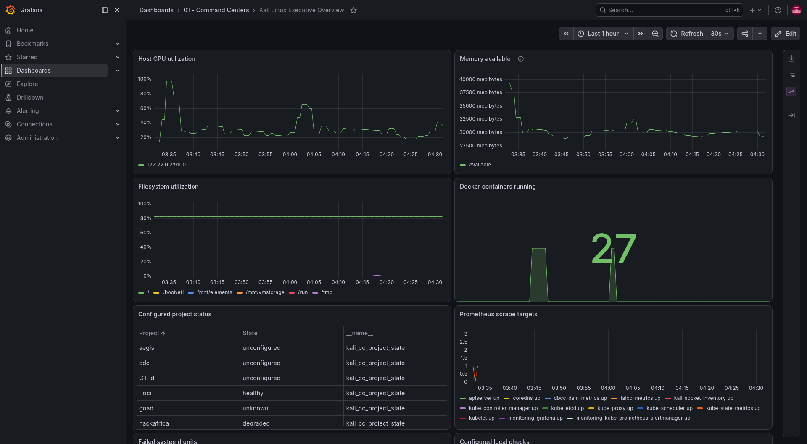
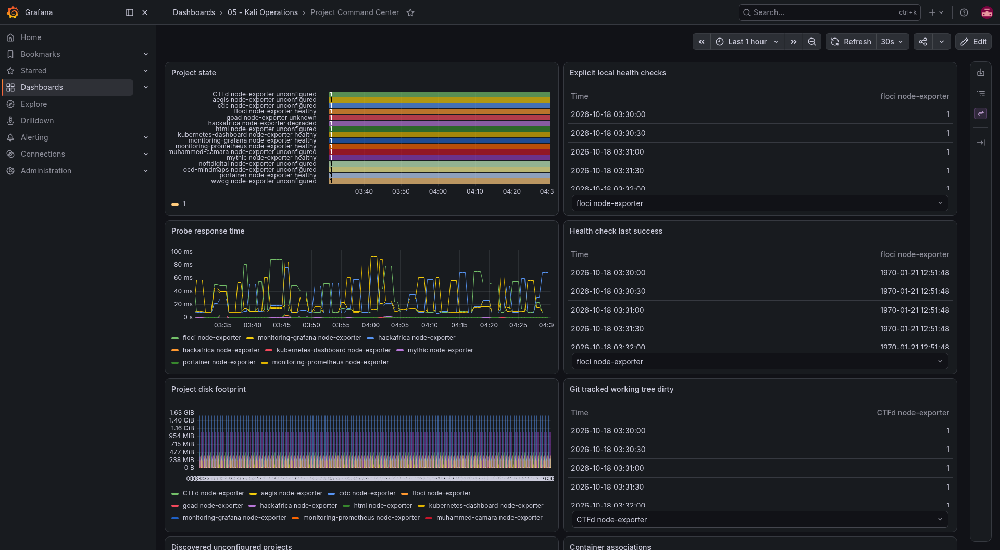
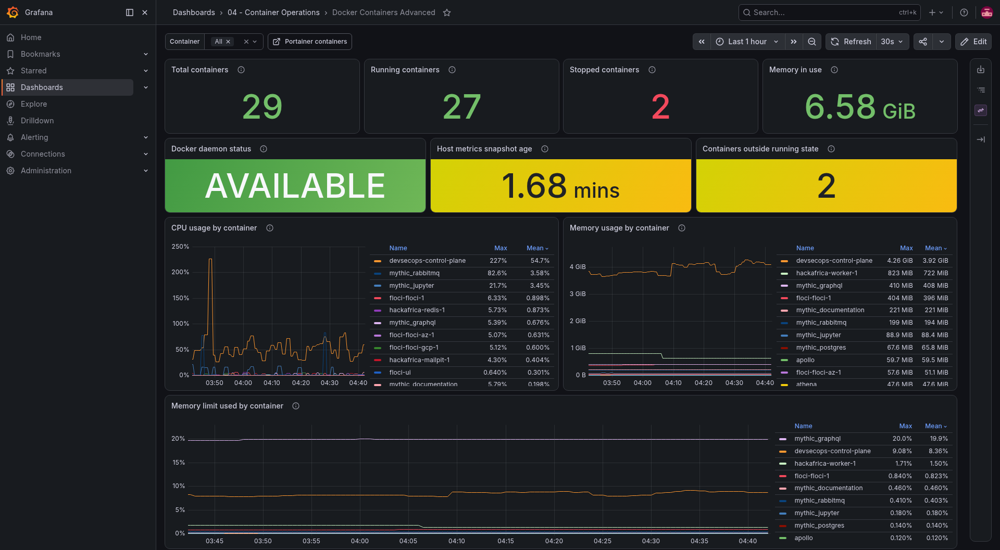
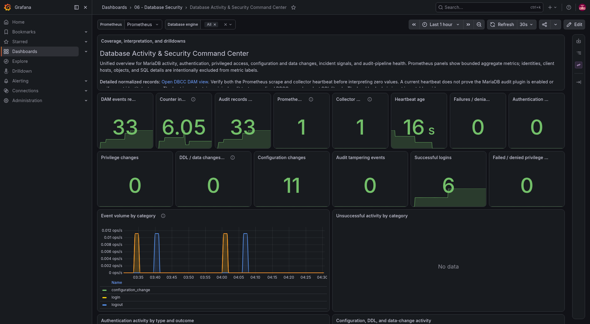
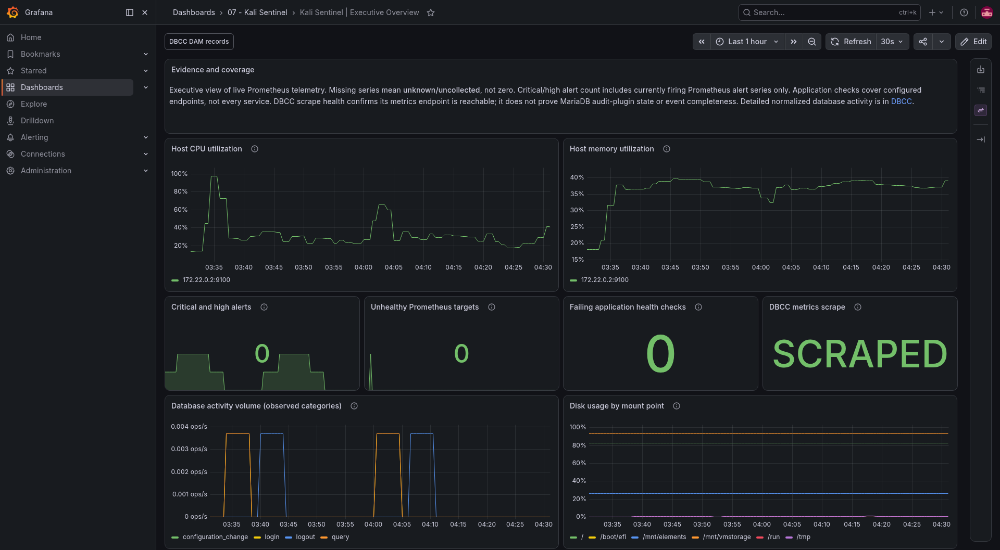
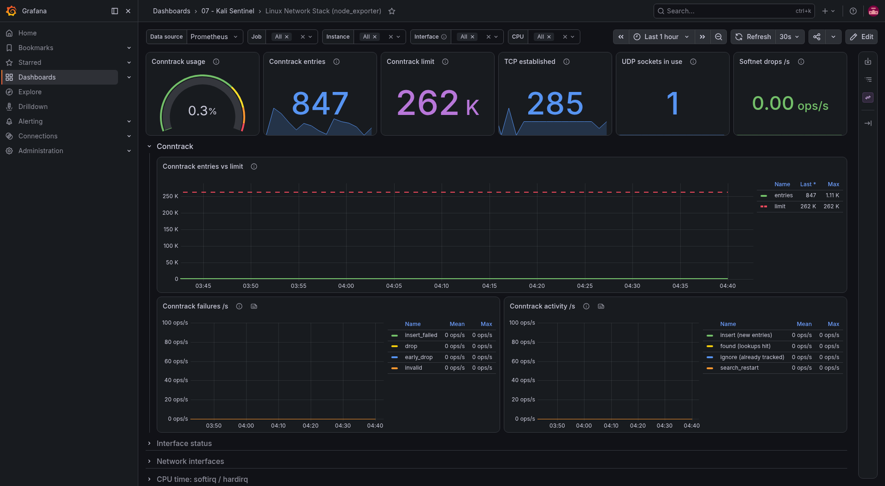
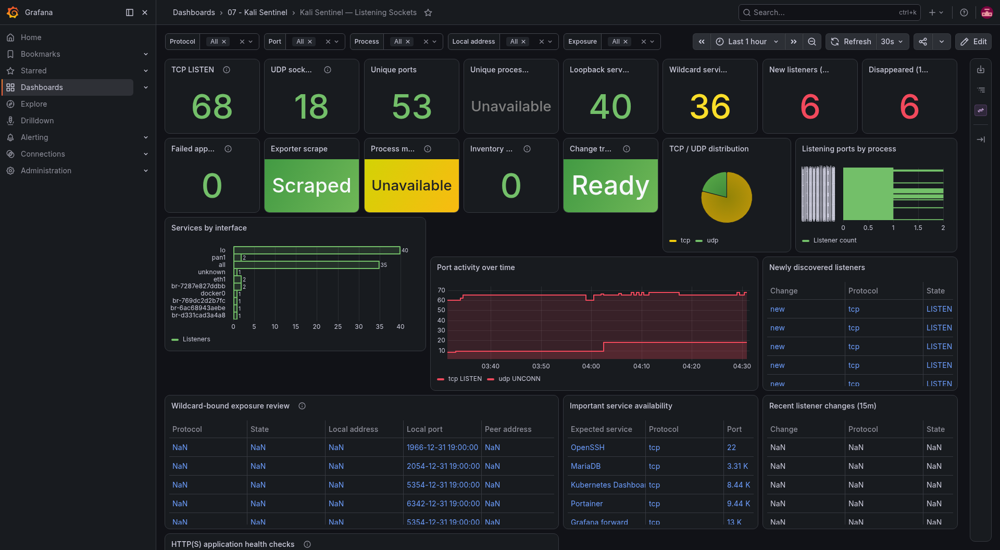

# LinkedIn screenshot selection

Seven readable original screenshots were selected to tell a compact portfolio story: operations, infrastructure, database auditing, security monitoring, and host networking. Start with the executive overview, then use the focused examples as supporting images.

These screenshots are original and unblurred. Before posting, inspect for any lab hostnames, addresses, paths, or values you do not want public. The full unmodified capture archive remains under `screenshots/`; the selected images are curated copies in `linkedin-assets/unblurred/dashboard-screenshots/`.

## Recommended post sequence

### Kali Linux Executive Overview — Broad executive snapshot

File: [`01-kali-linux-executive-overview.png`](linkedin-assets/unblurred/dashboard-screenshots/01-kali-linux-executive-overview.png) · [Full-resolution source](screenshots/22-kali-linux-executive-overview.png)

### Project Command Center — Project health and operational status

File: [`02-project-command-center.png`](linkedin-assets/unblurred/dashboard-screenshots/02-project-command-center.png) · [Full-resolution source](screenshots/07-project-command-center.png)

### Docker Containers Advanced — Container availability and resource use

File: [`03-docker-containers-advanced.png`](linkedin-assets/unblurred/dashboard-screenshots/03-docker-containers-advanced.png) · [Full-resolution source](screenshots/01-docker-containers-advanced.png)

### Database Activity & Security Command Center — Database audit and collection signals

File: [`04-database-activity-and-security-command-center.png`](linkedin-assets/unblurred/dashboard-screenshots/04-database-activity-and-security-command-center.png) · [Full-resolution source](screenshots/10-database-activity-and-security-command-center.png)

### Kali Sentinel | Executive Overview — Security monitoring overview

File: [`05-kali-sentinel-executive-overview.png`](linkedin-assets/unblurred/dashboard-screenshots/05-kali-sentinel-executive-overview.png) · [Full-resolution source](screenshots/15-kali-sentinel-executive-overview.png)

### Linux Network Stack (node_exporter) — Host and network observability

File: [`06-linux-network-stack-node-exporter.png`](linkedin-assets/unblurred/dashboard-screenshots/06-linux-network-stack-node-exporter.png) · [Full-resolution source](screenshots/20-linux-network-stack-node-exporter.png)

### Kali Sentinel — Listening Sockets — Listening socket inventory

File: [`07-kali-sentinel-listening-sockets.png`](linkedin-assets/unblurred/dashboard-screenshots/07-kali-sentinel-listening-sockets.png) · [Full-resolution source](screenshots/19-kali-sentinel-listening-sockets.png)
