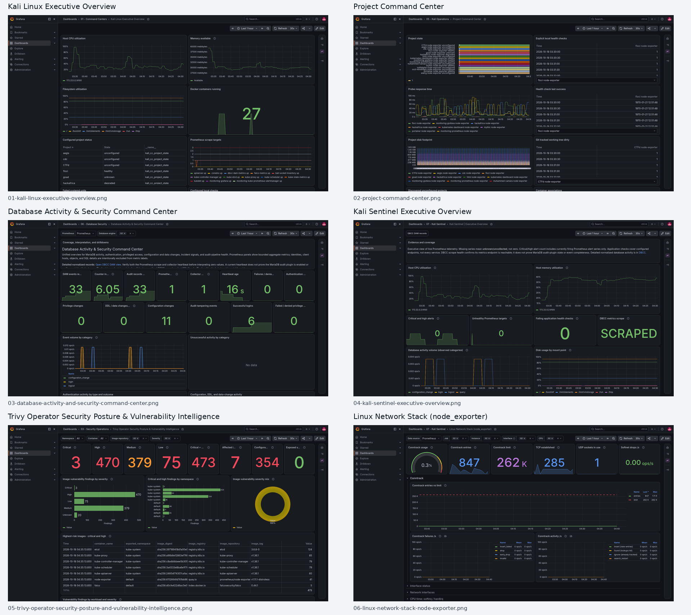

# LinkedIn post ready screenshots

This folder contains six selected, full-resolution, unblurred screenshots in a suggested post order, plus one preview contact sheet. Upload the individual PNGs to LinkedIn as a multi-image post. The preview sheet is for reviewing the set; use the individual images for posting.

Review the original unblurred screenshots for lab details you do not want public before posting.

## Kali Linux Executive Overview
Opens with a broad overview of the lab.
File: [`01-kali-linux-executive-overview.png`](01-kali-linux-executive-overview.png)

## Project Command Center
Shows project health and operational status.
File: [`02-project-command-center.png`](02-project-command-center.png)

## Database Activity & Security Command Center
Shows database audit collection and activity signals.
File: [`03-database-activity-and-security-command-center.png`](03-database-activity-and-security-command-center.png)

## Kali Sentinel Executive Overview
Shows the security monitoring view.
File: [`04-kali-sentinel-executive-overview.png`](04-kali-sentinel-executive-overview.png)

## Trivy Operator Security Posture & Vulnerability Intelligence
Adds image vulnerability and configuration findings.
File: [`05-trivy-operator-security-posture-and-vulnerability-intelligence.png`](05-trivy-operator-security-posture-and-vulnerability-intelligence.png)

## Linux Network Stack (node_exporter)
Closes with host and network telemetry.
File: [`06-linux-network-stack-node-exporter.png`](06-linux-network-stack-node-exporter.png)

## Preview sheet

