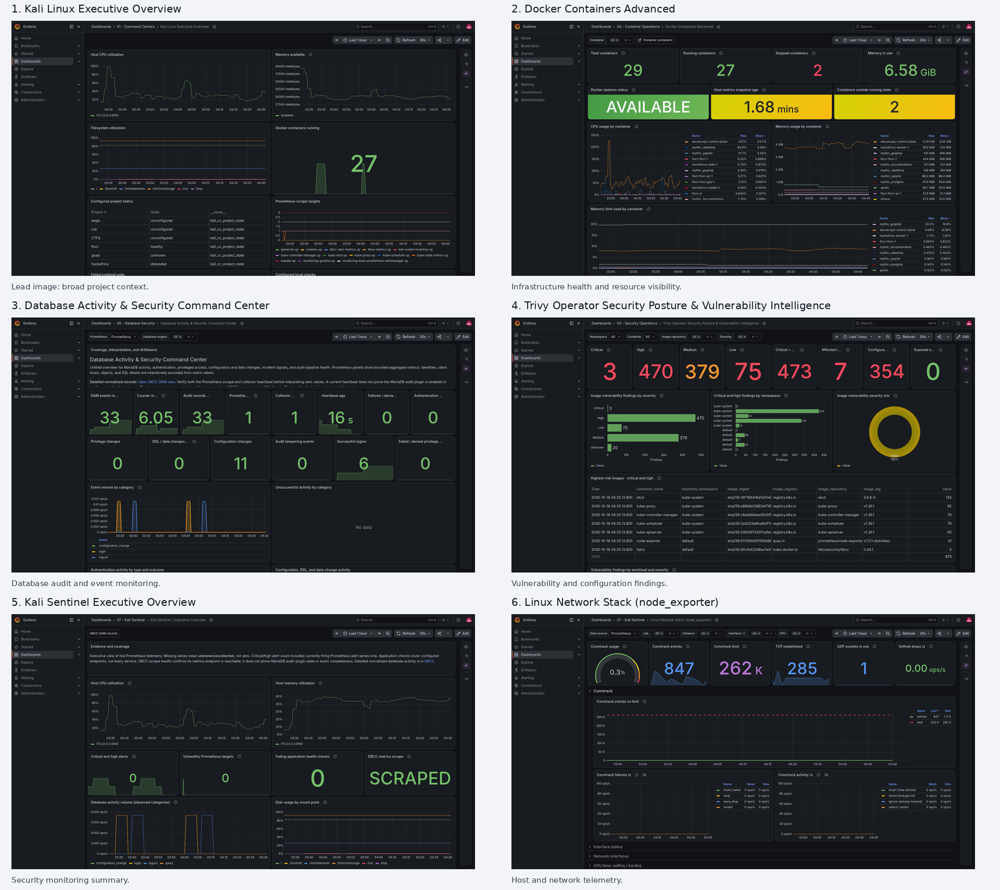

# LinkedIn top picks

Six strongest screenshots for one focused post, in recommended upload order. Upload the numbered PNGs as a multi-image post; the contact sheet is only a preview.

1. **Kali Linux Executive Overview** — establishes the project context.
2. **Docker Containers Advanced** — shows infrastructure monitoring.
3. **Database Activity & Security Command Center** — demonstrates database auditing.
4. **Trivy Operator Security Posture & Vulnerability Intelligence** — adds vulnerability findings.
5. **Kali Sentinel Executive Overview** — summarizes security monitoring.
6. **Linux Network Stack (node_exporter)** — shows host and network visibility.

Review unblurred values, names, addresses, and service labels before posting.

- [`01-kali-linux-executive-overview.png`](01-kali-linux-executive-overview.png) — Kali Linux Executive Overview
- [`02-docker-containers-advanced.png`](02-docker-containers-advanced.png) — Docker Containers Advanced
- [`03-database-activity-and-security-command-center.png`](03-database-activity-and-security-command-center.png) — Database Activity & Security Command Center
- [`04-trivy-operator-security-posture-and-vulnerability-intelligence.png`](04-trivy-operator-security-posture-and-vulnerability-intelligence.png) — Trivy Operator Security Posture & Vulnerability Intelligence
- [`05-kali-sentinel-executive-overview.png`](05-kali-sentinel-executive-overview.png) — Kali Sentinel Executive Overview
- [`06-linux-network-stack-node-exporter.png`](06-linux-network-stack-node-exporter.png) — Linux Network Stack (node_exporter)
## Preview

